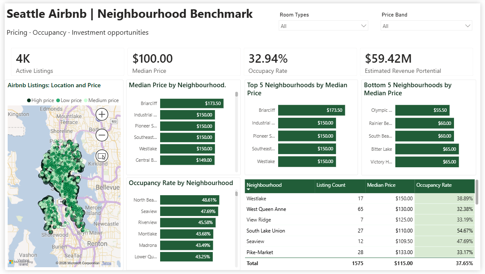
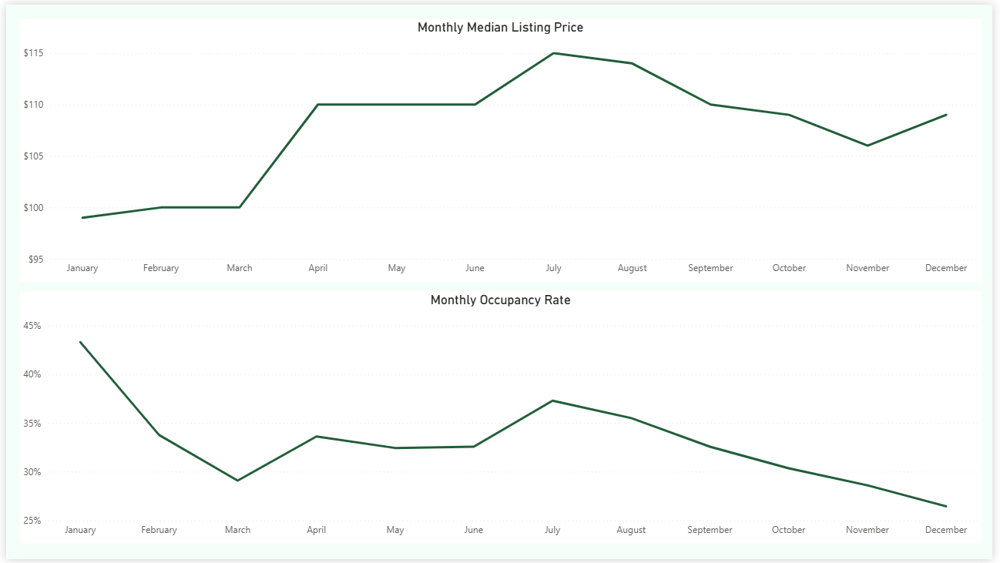
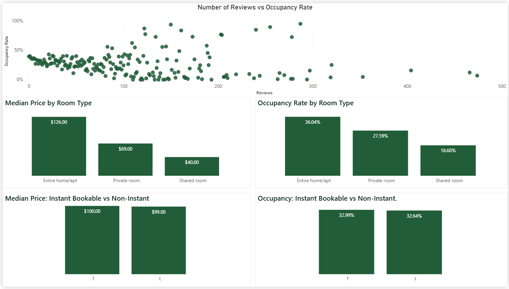
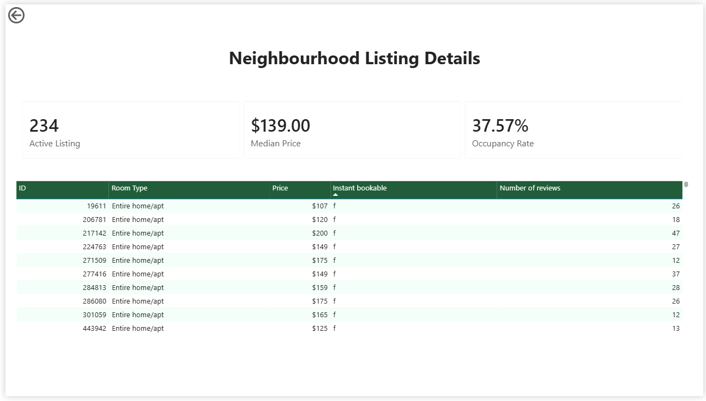
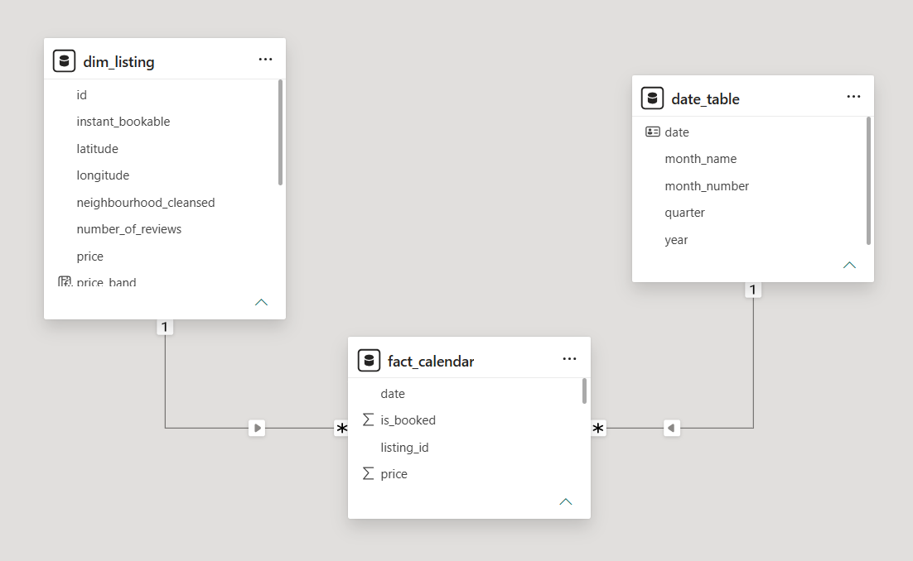

# Airbnb Pricing and Occupancy Analysis | Seattle

An interactive **Power BI data analytics project** exploring Airbnb listing prices, occupancy patterns, seasonality, and neighbourhood-level investment opportunities in Seattle.

This project transforms Airbnb listing and calendar data into an interactive report that helps users compare neighbourhoods, analyse pricing trends, and explore potential investment opportunities.

## Dashboard Preview

### 1. Neighbourhood Benchmark

Provides an overview of Airbnb listings across Seattle neighbourhoods, including listing counts, median prices, occupancy rates, investment-target analysis, and a map of listing locations.

The page also includes filters and comparative visuals to help users explore neighbourhood performance.



### 2. Seasonality

Explores monthly changes in median calendar prices and occupancy rates. The visualisations help identify seasonal price movements and changes in booking-related patterns throughout the year.



### 3. Listing Characteristics

Compares median prices and occupancy rates across room types and instant-booking groups. A scatter plot explores the relationship between the number of reviews and listing occupancy.

These comparisons provide descriptive insights into listing characteristics and their relationship with pricing and occupancy.



### 4. Neighbourhood Detail

A drill-through page that provides a more detailed view of a selected neighbourhood, including listing count, median price, occupancy rate, and listing-level information.

Users can navigate from the neighbourhood overview to this page to investigate a specific area.



## Data Model

The report uses a **star-schema-style data model** consisting of three main tables:

- **`dim_listing`** — listing attributes, including listing ID, neighbourhood, room type, and listing price.
- **`fact_calendar`** — daily calendar records containing listing IDs, dates, availability status, and calendar prices.
- **`date_table`** — a dedicated date dimension for time-based analysis.

Active, single-direction relationships connect `dim_listing` and `date_table` to `fact_calendar`. The date table is marked as the official Date table, and month names are sorted by month number to ensure chronological ordering.



## Key Metrics and Measures

- **Active Listings:** Distinct count of listings represented in the calendar fact table within the current filter context.
- **Booked Nights:** Sum of the `is_booked` flag, where `available = "f"` is treated as a booked night for this analysis.
- **Occupancy Rate:** Booked calendar rows divided by calendar rows in the current filter context.
- **Median Price:** Median listing price used to compare typical prices across neighbourhoods.
- **Calendar Median Price:** Median of non-blank calendar prices, used to analyse monthly pricing trends.
- **Estimated Revenue Potential:** An estimate based on rows classified as booked, using calendar prices when available and listing prices as a fallback.
- **Investment Target:** Identifies neighbourhoods whose median price and occupancy rate are both above the relevant neighbourhood benchmarks.

## Data Preparation and Modelling Decisions

- Cleaned price fields by removing currency symbols and thousands separators and converting values to numeric data types.
- Used `neighbourhood_cleansed` because the original neighbourhood field contained missing values.
- Created an `is_booked` flag from the calendar availability field.
- Preserved blank calendar prices rather than treating them as zero.
- Created a dedicated date table with year, month number, month name, and quarter fields.
- Sorted `month_name` by `month_number` to display months chronologically.
- Used median price instead of average price for neighbourhood comparisons because the median is less sensitive to extreme prices and outliers.
- Added price bands, conditional formatting, slicers, Top/Bottom neighbourhood comparisons, a listing map, and a drill-through page.
- Kept the `investment_target = 1` filter limited to the investment-target visual. This filter highlights neighbourhoods meeting the report's investment-screening criteria and does not need to restrict the general neighbourhood comparison or unrelated Top/Bottom visuals.

## Important Interpretation Notes

### The `available = "f"` Trap

In the source calendar data, `available = "f"` means that a date is unavailable. In this report, these rows are treated as booked nights for occupancy analysis. However, unavailable dates may also reflect owner blocking or other reasons. Therefore, the calculated occupancy rate should be interpreted as an analytical estimate rather than verified reservation data.

### Occupancy Rate Calculation

Occupancy Rate divides the number of calendar rows classified as booked by the number of calendar rows in the current filter context. The result changes according to the selected date range, neighbourhood, and room type.

### Median Price vs Average Price

The median is the middle value when prices are ordered from lowest to highest. Unlike the average, it is less affected by unusually expensive listings. This makes it useful for comparing typical listing prices across neighbourhoods where prices may be skewed.

### Estimated Revenue Limitations

Estimated Revenue Potential is not actual Airbnb revenue. It uses calendar prices when available and falls back to listing prices for booked rows with blank calendar prices. Actual revenue may differ because of discounts, fees, cancellations, and other factors not represented in the dataset.

### Descriptive Analysis

Differences across neighbourhoods, room types, and instant-booking groups show patterns in the data, not causation. Property quality, operating costs, seasonality, competition, and other factors may also influence investment performance.

## Investor Insights

The report supports five main investment-analysis questions:

1. **Neighbourhood Pricing:** Which neighbourhoods have the highest median listing prices, and do they also demonstrate strong occupancy?
2. **Occupancy Performance:** Which neighbourhoods have the highest occupancy rates, and how many listings support those results?
3. **Price–Occupancy Balance:** Which neighbourhoods combine comparatively lower median prices with stronger occupancy?
4. **Top vs Bottom Neighbourhoods:** How do the highest- and lowest-priced neighbourhoods compare in occupancy and listing count?
5. **Investment Target Screening:** Which neighbourhoods have both median prices and occupancy rates above the relevant neighbourhood benchmarks?

Specific neighbourhood names and values should be taken from the final report visuals, taking active filters into account.

## Repository Structure

```text
.
├── README.md
├── airbnb_report.pbix
├── model_view.png
├── note.md
├── data/
│   ├── listings.csv
│   └── calendar.csv
└── dashboards/
    ├── neighbourhood_benchmark.png
    ├── seasonality.png
    ├── listing_characteristics.png
    └── neighbourhood_detail.png
```

## Project Files

| File or Folder | Description |
|---|---|
| `airbnb_report.pbix` | Editable Power BI report |
| `README.md` | Project overview and dashboard previews |
| `note.md` | Detailed modelling decisions, measure explanations, limitations, and insights |
| `model_view.png` | Screenshot of the Power BI model view |
| `data/` | Source datasets used for the analysis |
| `dashboards/` | PNG exports of all report pages |

## Tools and Technologies

- Microsoft Power BI
- Power Query
- DAX
- Star-schema data modelling
- Data cleaning and exploratory data analysis
- Data visualisation

## How to View the Project

1. Open `airbnb_report.pbix` in Power BI Desktop to explore the interactive report.
2. View the dashboard screenshots in the `dashboards/` folder.
3. Open `model_view.png` in the repository root to inspect the data model.
4. Read `note.md` for detailed modelling decisions and measure explanations.
5. Find the source datasets in the `data/` folder.


